 <div align="center">



Building practical software, AI-powered applications, and cloud-native systems.

[](https://github.com/salujadivyam)
[](https://linkedin.com/in/salujadivyam)

</div>

---

## `> whoami`

```yaml
name: Divyam Saluja
education: Computer Science Engineering @ MIT Bengaluru
previously:
  - AI, GenAI & Agentic AI — IIT Jammu (June–August 2025)
  - Technical Intern — Comviva (Tech Mahindra) (September–November 2026)
focus:
  - Cloud & DevOps
  - AI/ML
  - System Design
  - Software Development
currently: Preparing for SDE-1 placements
```

---

## Projects

<table>
<tr>
<td width="50%" valign="top">

### [Faunoryx](https://github.com/salujadivyam/Faunoryx)

<a href="https://github.com/salujadivyam/Faunoryx">

</a>

A wildlife tracking platform for 149 simulated tigers in Nagarahole Tiger Reserve, built using Azure services, live telemetry, geofencing, and anomaly detection.

**Tech:** Python, Azure Event Hubs, Azure Functions, Azure SQL, Terraform, Azure Maps

[Repository](https://github.com/salujadivyam/Faunoryx)

</td>
<td width="50%" valign="top">

### [SpoilFree](https://github.com/salujadivyam/spoilfree)

<a href="https://github.com/salujadivyam/spoilfree">

</a>

A Chrome extension designed to detect and blur spoilers, helping users browse content without accidentally revealing plot details.

**Tech:** JavaScript, Chrome Extensions

[Repository](https://github.com/salujadivyam/spoilfree) · [Chrome Web Store](https://chromewebstore.google.com/detail/engnnicbnpddglmkndeaopiokibakdhg/preview?hl=en&authuser=0)

</td>
</tr>
</table>

### More Projects

<table>
<tr>
<td width="50%" valign="top">

### [Elricus](https://github.com/salujadivyam/elricus)

A Telegram bot built with `asyncio` and Aiogram, featuring an AI-powered chatbot, image generation, audio descriptions, text-to-speech, and multimodal interactions.

**Tech:** Python, asyncio, Aiogram, AI APIs

[View Repository →](https://github.com/salujadivyam/elricus)

</td>
<td width="50%" valign="top">

### [LoomFit](https://github.com/salujadivyam/loomfit)

An ultimate candidate-screening platform featuring hybrid semantic and keyword matching, detailed candidate gap analysis, job-description bias auditing, and an interactive recruiter Q&A interface.

**Key Features:** Hybrid Matching · Gap Analysis · JD Bias Auditing · Recruiter Q&A

[View Repository →](https://github.com/salujadivyam/loomfit)

</td>
</tr>
<tr>
<td width="50%" valign="top">

### [CrewAI Interview Simulator](https://github.com/salujadivyam/crewai-interview-simulator)

An AI-powered interview simulation project built around multi-agent workflows.

[View Repository →](https://github.com/salujadivyam/crewai-interview-simulator)

</td>
<td width="50%" valign="top">

### [n8n Research Paper Reader](https://github.com/salujadivyam/n8n-research-paper-reader)

An automated research-paper workflow integrating the arXiv API with Airtable to retrieve and organize research papers.

**Tech:** n8n, arXiv API, Airtable

[View Repository →](https://github.com/salujadivyam/n8n-research-paper-reader)

</td>
</tr>
</table>

---

## Technical Skills

**Languages**


**AI / Machine Learning**


**Backend / Automation**


**Cloud / DevOps**


**Databases / Mapping**


**Core Computer Science**


---

## GitHub Statistics

<div align="center">




</div>

## Contribution Activity

<div align="center">


</div>

---

<div align="center">

*Building, learning, and improving one project at a time.*

</div>
